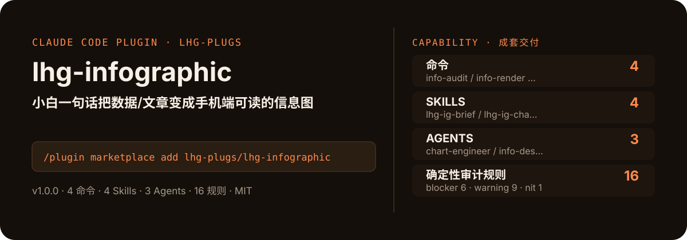

<!-- About 简介（推送后填写到仓库 About 栏）：
小白一句话把数据/文章变成手机端可读的信息图：图表选型、Canvas 确定性绘制、16 条数据-图表映射与可读性审计，拒绝瞎画图。 ｜ 一键安装：/plugin marketplace add lhg-plugs/lhg-infographic
-->
<!-- topics（推送后打）：claude-code, claude-plugin, agent-skills, infographic, chart, data-visualization, canvas, chinese -->

<p align="center">
  
</p>

> **一句话介绍**：小白一句话把数据/文章变成手机端可读的信息图：图表选型、Canvas 确定性绘制、16 条数据-图表映射与可读性审计，拒绝瞎画图。

**一键安装**：在 Claude Code 里运行

```bash
/plugin marketplace add lhg-plugs/lhg-infographic
/plugin install lhg-infographic@lhg-plugs
```

## 它能帮你做出什么

每条产出先过确定性脚本自查，再交人工复核清单——数字全部数自仓库里的审计脚本，不靠模型"自觉"。

| 自查脚本 | 规则数 | blocker | warning | nit | 覆盖 |
|---|---|---|---|---|---|
| `scripts/audit/infographic_audit.py` | 16 | 6 | 9 | 1 | 标题、来源、映射、字号、颜色、数据 |
| **合计** | **16** | **6** | **9** | **1** | |

- **零 LLM 成本**：规则是纯 Python 脚本，零第三方依赖，本地运行。
- **坏 / 好对照可验**：`fixtures/` 里备有坏/好用例，冒烟测试断言命中情况。
- **冒烟全绿**：`python3 smoke_test.py` 53 项全部通过（JSON 合法、frontmatter 完整、命令/skill/agent 齐全）。

## 它是什么

`lhg-infographic` 是一个 Claude Code 插件（plugin 为主、skill 为辅）：

- **4 个命令**（小白入口）：`info-audit` 对 chart-spec.json 跑 、`info-render` 按 chart-spec.json 用 、`info-select` 按数据特征选图表类型、`infographic` 一句话把数据/文章变成信息图
- **4 个平台中立 skill**（方法论，可移植到豆包/Workbuddy 等 agent 平台）：lhg-ig-brief, lhg-ig-chart, lhg-ig-render, lhg-ig-review
- **3 个专家 agent**：chart-engineer, info-designer, info-reviewer
- **2 个 hooks**（`hooks/`：post_write_source_warn.py, pre_commit_audit.py），关键操作前自动把关
- **16 条确定性自查规则**：纯 Python 脚本，见上表

## 为什么是它

不是一个 prompt，而是一套互相兜底的机制：

1. **确定性脚本（机器）+ 人工复核清单（人）**：先跑 `scripts/` 下的审计脚本（共 16 条规则），发现分三级：**blocker**（必须修）、**warning**（修或写豁免理由）、**nit**（顺手修）；再按对应 skill 的复核清单过一遍脚本抓不到的（内容真实性、越权、口径一致）。blocker 清零才算做完；为清零改规则算作弊，不许。
2. **硬门，不是提醒**：hooks 在关键操作前自动拦截或警告（见 `hooks/`），而不是只在文档里写一句"请注意"。
3. **方法论沉淀在 skill 里**：流程、检查清单、口径都写在 `skills/` 的方法论里，命令只是入口；换个 agent 平台也能复用同一套做法。
4. **可验，不是可信**：`fixtures/` 备有坏/好对照用例，`smoke_test.py` 一键验证，规则有没有生效、自己跑一遍就知道。

## 快速上手

```bash
# 1. 安装（Claude Code 里运行）
/plugin marketplace add lhg-plugs/lhg-infographic
/plugin install lhg-infographic@lhg-plugs

# 2. 一句话把数据/文章变成信息图：需求澄清 → 数据整理 → 图表选型 → Canv
/lhg-infographic:infographic "Q3销量数据 公众号"
```

| 命令 | 作用 | 示例 |
|---|---|---|
| `/lhg-infographic:info-audit` | 对 chart-spec.json 跑 16 条确定性审计（映射/字号/颜色/数据/标题来源）+ 手机端可读性人工评审… | `/lhg-infographic:info-audit` |
| `/lhg-infographic:info-render` | 按 chart-spec.json 用 Canvas 2D 确定性绘制信息图：标题/坐标轴/来源/字号/颜色全按规范来… | `/lhg-infographic:info-render chart-spec.json` |
| `/lhg-infographic:info-select` | 按数据特征选图表类型：趋势/构成/比较/分布四象限决策树，输出选型结论与理由，写入 chart-spec.json。 | `/lhg-infographic:info-select "月度销量趋势"` |
| `/lhg-infographic:infographic` | 一句话把数据/文章变成信息图：需求澄清 → 数据整理 → 图表选型 → Canvas 绘制 → 手机端可读性自检 → 确… | `/lhg-infographic:infographic "Q3销量数据 公众号"` |

## 什么时候用 / 什么时候不用（FAQ）

**什么时候用：**

- 你需要对 chart-spec.json 跑 16 条时 → 用 `/lhg-infographic:info-audit`
- 你需要按 chart-spec.json 用 Canv时 → 用 `/lhg-infographic:info-render`
- 你需要按数据特征选图表类型时 → 用 `/lhg-infographic:info-select`

**什么时候不用：**

- 你只需要其中一个零散能力时 → 本插件是成套流程，单点需求用更轻量的 skill 更合适
- 你希望 AI 完全自由发挥、不接受任何自查与硬门时 → 它的规则审计与 hooks 会介入（可关，但那就别装它）
- 你的场景不在上面命令表覆盖范围内时 → 先看命令表，没有对应命令就别硬套

## 目录结构

```
lhg-infographic/
├── smoke_test.py          # 一键冒烟测试
├── ATTRIBUTION.md         # 灵感来源与许可声明
├── LICENSE                # MIT
├── README.md              # 本文件
├── .claude-plugin/
├── agents/
├── commands/
├── fixtures/
├── hooks/
├── scripts/
├── skills/
```

## 自检与反馈

本插件自带质检：每次使用后可跑 `python3 smoke_test.py` 一键验证（本次实测 53 项全部通过）。

发现 bug 或有改进建议，以 `[QC] <一句话问题>` 为标题提交到 https://github.com/lhg-plugs/lhg-infographic/issues，正文写清"复现步骤 → 实际表现 → 期望表现"。

同门插件见 [lhg-plugs](https://github.com/lhg-plugs)，86 个插件的完整矩阵在 [marketplace](https://github.com/lhg-plugs/marketplace) 维护。

## 出品：刘洪光

本插件由真人出镜 IP「刘洪光」（安徽合肥）出品，归属 [lhg-skills](https://github.com/lhg-skills)。

- GitHub 主页：https://github.com/lhg-skills —— 全部 skill 开源在此，欢迎 star
- 抖音：搜「刘老师讲AI实战」
- 微信：lhgsmsw
